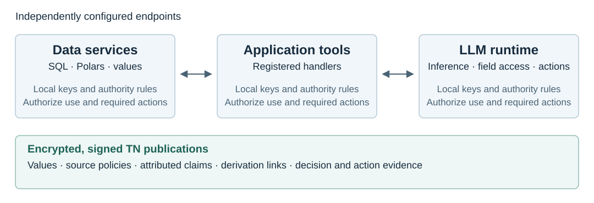

# TN Governed

TN Governed is a framework for applying data-use policies across LLM applications, tools, and data processing services. It supports workflows that combine database queries, dataframe operations, calculations, tool calls, and model inference while retaining the conditions attached to the source data.

Data-use conditions can specify a permitted purpose, a disclosure destination, or an action required before processing. Calculations, tool results, and model outputs can depend on several sources with different conditions. The SQL, Polars, tool, and inference integrations retain those source conditions in derived publications. Each receiving runtime evaluates the requested use under its configured rules before opening protected values.

The framework represents protected content as governed values and artifacts. Each encrypted, signed TN publication contains the value and its governance, including source policies, attributed claims, and derivation links. Signed decisions and action records provide evidence of the processing performed. A receiving service can verify the authorship and integrity of source statements and evaluate the requested use under its own authority configuration.



## Core components

`Endpoint` provides the execution boundary for a service, tool, or recipient. Each instance has its own keys, recognized authorities, policy evaluator, and required-action handlers. Before protected computation, `Endpoint` verifies the inputs, obtains a policy decision, and completes required actions. Successful computation produces a governed artifact containing the result and source governance. Disclosure as an ordinary value requires authorization for a named destination.

`ToolWorkflow` executes registered tools over governed inputs. Tool registration specifies the handler and its input and output schemas. The workflow validates requests, executes dependent calls in order, and publishes a final result after the required calls and release actions have completed.

The native llama.cpp integration controls access to encrypted input fields, verifies required tool completions, and publishes governed model outputs. The native runtime performs these checks within the inference service using its configured policies and keys.

`GovernedSQL` and `GovernedLazyFrame` publish SQL and Polars results as native TN publications. Query results, transformations, and aggregates retain source policies, original claim attribution, and contributor information for subsequent processing and recipient verification.

## Governed string through Polars

The example helper [`originate`](examples/local_policy.py) creates a `TNString` from `"alice"` under the supplied policy. `pl.Object` preserves that `TNString` instance in a regular Polars dataframe column. `map_elements` invokes `TNString.upper()` on the stored object; `Context` authorizes the operation, decrypts the input within the runtime, computes the uppercase text, and encrypts the derived result.

`context` is a configured `Context` containing a native `Session`, a policy evaluator, and required-action handlers. The `Session` provides the keys and native publication operations. `policy` is the selected source contract. The sequence returns a governed `TNString`; the separate `GovernedLazyFrame` interface covers governed dataframe expressions and plans.

```python
name = originate(context, "alice", policy, "name")
frame = pl.DataFrame({"name": [name]}, schema={"name": pl.Object})

with context:
    frame = frame.with_columns(
        frame["name"].map_elements(TNString.upper, return_dtype=pl.Object)
    )

result = frame["name"][0]
ciphertext = result.publication.object.envelope["values"]["ciphertext"]
print("Encrypted:", ciphertext)
print("Decrypted:", result.reveal(context, destination="console"))
```

The first print displays the encrypted content of the transformed value. `TNString.reveal()` obtains authorization for `console`, decrypts the value, and returns the ordinary string for the second print:

```text
Encrypted: twEBf9GbRFrI0kqGcAP4YXvWmpn6ReGXqSX+i1ooaVbt0z0AAAAAAAEAScZ1UzHZwNeAM351j/mKatkEWRg5h7z8gDY4h4N57IHb4isgmEhfh3jyfRWsoz7n5W1OPQAAACG/vsyi6uLcFdz7cOBm+AgyhshwCcd/JHj08P1Q9f8j2cU=
Decrypted: ALICE
```

### Policy in the same publication

The `string.processing` policy states the permitted operations, purpose, destination, and monitoring requirement. In this example, `evaluate(request)` is the evaluator registered on `Context`: it checks the requested use and adds the required `monitor` action to permitted decisions. `Context` invokes its registered monitoring handler to sign the record before protected processing. The transformed publication contains the source policy in its encrypted `tn.agents` group.

`Session.governance()` verifies the publication and decrypts its governance using the session's keys. `carried_policy.fields` contains the policy recovered from the publication:

```python
publication = result.publication.object
print("Encrypted policy:", publication.envelope["tn.agents"]["ciphertext"])
carried_policy = context.session.governance(publication).governance.policies[0]
print("Decrypted policy:", json.dumps(carried_policy.fields, indent=2))
```

```text
Encrypted policy: twEBrx+JrC3vFWN//oq0J2sHxEHj+V299IMLeiPbe/5sP14AAAAAAAEAF2vK95Xrtu2G+cqoRHV7Q1nScWz2OEtjTmwwbNsn+wMsYBqP6O8xsyYuwge85/arbi29hQAAA08CTQNfj7uvLkVFLRGhNdQ5zbep+/cCv+V9TGisu2kvZCh61uN/Of5GRe2vhpleKN4eeflMuotEn4fb/UJsA7yV/3sr+0K032RkkbxTt9hrlI5ibIGVlh6nPrjZNO9v/JLbC8BdiQ7MZvUqaICCGVuRUojOu/Jshoz/8hCUGnYVl1quYdVQpkGxp5BR3vBl889sJtSpbMx1jDzADEM655NxxwXQVRTv6HRX4Z3+UbpJ03BmzEw3WpvsnRBAzxZTlJDwu8S+Fi/+j1y7zHHZHuxbA9z3qhacUEsEiKpk/sK38fQCPIvUAY2k7UgW0ihcgj+agAn/vlxDX2vZhOQcAyUlXWoQS5YNSL6IK1uuVV8Bj1ZW8M8KDOLQjyZzz/QnUhGdOTTNsZvdEWbYDkzgs2gV0HZkULha4P6TYzs0j5A1T2wxoNWwkZBLTh/wNdn+Lq68P7vaPTFJaYlV9sV1kFc2/8JOZl23k4xDwQ/j7Kip7U2Soj6PPE6lgoMV8r6IUpYgh8GIHpfQvnmab7Vgc3xTqScLpZWKw4S2N09t1BGObN2zLn3qWz4Y00yOQ8NMRzgpKh6Q19Ur+ncEw7WEbl0q+dNz1ztawbO9B7X9Go0pdoCIpXRrWLXZ8leeagGIifIxzhu8NV9HLcPykIWGEBbqsjKRdk7p6tvX5lrPheyoLPNh7njI2kHcEo0jw4ykENOGMwHkZViq17v+Ndz/o2BquVRSi1ut0+N5S7kiOaF0EQis0OAmOq8mEE1zyFJ/aZ7/4CrN9d00AdjS3Zzqneb7Io4MbWIsi2CwNrxY4hf4k/RWEVTnyh3wlBps2aa8/ehDdg8+KvpnsD80eH1meLXOEfbYKoSgKro8VVvUSa2cfvZECqHo8OJZl7wVXJXmNWtQISBQxMpYE1IgExuClQV0QwGyObdLvEbviCfIfQuPSaec+7O6LbwipieUFQt4bUv2l/8s94vK21YyJDxnToSU50ajyzpvOF/OEN9V3krqjTcv/ADTFxIXcnT1Cz7/Yc12w9zkD5GzThsTNmvyC2jiOL6l10NHREkR3p4MKlDVHLm2EHy9sD2RmT+1fsimmtsBTIdGI9T9ZCA+SMhxpvqPDgrac1QOJEb9W7vrAquO
Decrypted policy: {
  "consequences": "Retain signed decisions, results, disclosures, and monitoring records.",
  "do_not_use_for": "Other applications, purposes, operations, or disclosure destinations.",
  "instruction": "Retain the source policy and input references when deriving a value.\nWrite a signed monitoring record before each protected operation.",
  "on_violation_or_error": "Record the refusal or failure and stop the protected operation.",
  "policy": "string_processing.policy#string.processing@1#sha256:1e882ad84e8347a94e8a88ba1a47349aa3cad99efece907594f66b4dbd43415e",
  "use_for": "The string-polars application may create and uppercase strings for the\nnormalization purpose. Ordinary output may be disclosed to console."
}
```

The [runnable example](examples/string_polars.py) includes the imports, [policy](examples/string_processing.policy), and endpoint configuration:

```sh
uv run python examples/string_polars.py
```

## Installation

Build requirements are Python 3.12, [uv](https://docs.astral.sh/uv/), Rust 1.95 or newer, and a C/C++ toolchain. Environment creation from the repository root:

```sh
uv sync --locked --extra dev
```

`uv sync` builds the included native TN SDK through Maturin and installs the local Polars adapter and model client. Windows builds require the Visual Studio C++ Build Tools. `examples/governed_tools.py` requires this Python environment.

The SQL/Polars examples also use Unity Catalog and OPA. Native LLM inference uses the included server integration and compatible GGUF model weights. [Installation and native builds](docs/installation.md) covers these components and their configuration.

## Tool workflow example

```sh
uv run python examples/governed_tools.py
```

Output:

```text
{"scaled": 36}
Retained claims: 1
Verified signed records: 9
```

[governed_tools.py](examples/governed_tools.py) loads [tool_workflow.policy](examples/tool_workflow.policy), originates the value `12`, attaches a claim, and registers a scaling handler. The example registers `evaluate(request)` as the policy evaluator on `Endpoint`. `Endpoint` invokes that callback to check the application, purpose, permitted operations, recognized writer, source contract, and disclosure destination. The registered tool multiplies the value by `3`; the final JSON output is `{"scaled": 36}`.

The following excerpt requires a configured `Endpoint` instance named `endpoint` and a `GovernedArtifact` named `amount`:

```python
from tn_governed.tool_runtime import Call, ToolRegistry, ToolSpec, ToolWorkflow

tools = ToolRegistry((ToolSpec(
    "scale",
    input_schema={
        "type": "object",
        "properties": {"factor": {"type": "number"}},
        "required": ["factor"],
        "additionalProperties": False,
    },
    output_schema={"type": "number"},
    handler=lambda invocation: invocation.values[0] * invocation.arguments["factor"],
),))
workflow = ToolWorkflow(endpoint, tools, {"amount": amount}, required_tools=("scale",))
completion = workflow.execute(
    Call("scaled", "scale", {"factor": 3}, inputs=("amount",))
)
```

`ToolWorkflow.execute()` returns a `ToolCompletion`. Its `artifact` field contains the governed result, and its `handle` field contains the result identifier `result:scaled` for subsequent calls. `ToolWorkflow.finish(value, schema=..., destination=...)` validates and publishes the final workflow artifact. `Endpoint.reveal(artifact, destination=...)` returns an ordinary value after destination-specific authorization. `workflow.expose(completion.handle, destination=...)` resolves the result handle and invokes the same disclosure operation.

## Interfaces

| Interface | Use |
| --- | --- |
| `Endpoint` | Originate, transform, attest, disclose, export, and receive governed JSON artifacts. |
| `ToolWorkflow` | Execute registered tools, retain call dependencies, and gate workflow release. |
| Native LLM runtime | Admit governed inputs, authorize field access and tool actions, and release governed model outputs. |
| `TNString`, `TNNumeric`, `Context` | Apply string and numeric operations while retaining source governance. |
| `GovernedSQL` | Publish parameterized SQLite query results with source policies and value/control dependencies. |
| `GovernedLazyFrame` | Apply Polars expressions and plans, retaining policies, claims, and contributor information. |
| `AuthorityEvaluator`, `ValueHistory` | Configure local authority decisions and required actions; retain signed value revisions. |

[Governed execution](docs/governed-execution.md) specifies endpoint authorization, required actions, claim attribution, and artifact transfer. [Interfaces and source layout](docs/interfaces.md) lists the implementation modules.

## Documentation

| Guide | Contents |
| --- | --- |
| [Installation and native builds](docs/installation.md) | Python environment, model-server builds, Unity, OPA, and runtime configuration. |
| [Tool workflows](docs/tool-workflows.md) | Registered tools, dependent calls, remote results, and governed release. |
| [Governed execution](docs/governed-execution.md) | Endpoint authority, required actions, claims, and artifact transfer. |
| [SQL query results](docs/sql-query-results.md) | Queries, contributor mappings, signed results, and disclosure. |
| [Polars adapter](dependencies/tn-polars/README.md) | Governed expressions, lazy plans, and dataframe publications. |
| [Examples](docs/examples.md) | Scalar operations, SQL/Polars, calculations, and an LLM report application. |
| [Evaluation](docs/evaluation.md) | Workloads, timing boundaries, recipient checks, and fault experiments. |

Research paper: *Governance That Travels: Governed Values Across SQL, Dataframes, and Language Models*.
