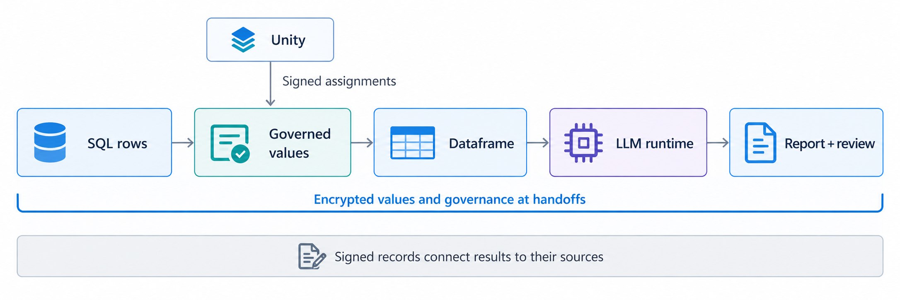
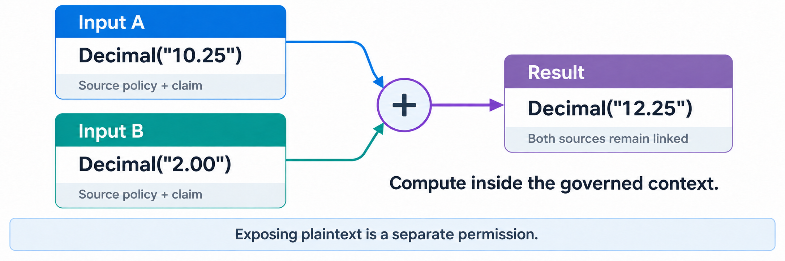
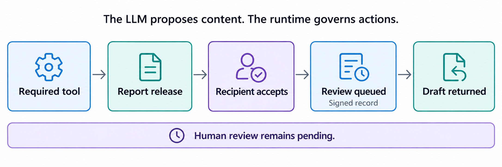
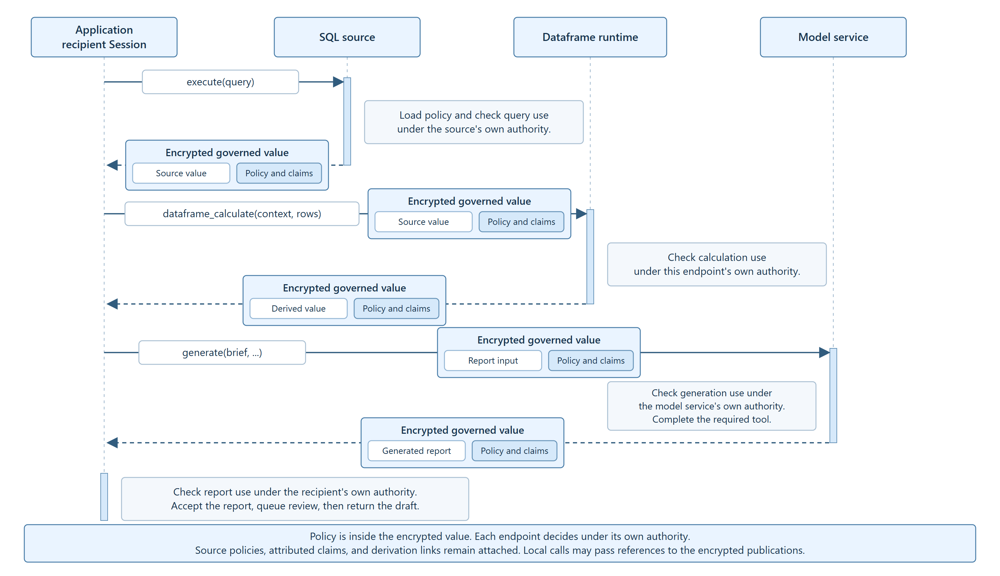

# Governance That Travels

Source companion to **Governance That Travels: Governed Values Across SQL, Dataframes, and Language Models**.

Applications can enforce access controls when reading a database and still lose the conditions attached to that data when they calculate a result or generate a report. A later recipient needs to know where the result came from, what the sources said about its use, and which required actions remain.

TN keeps that information connected to individual string and numeric values. A governed value carries the basis for accountable decisions about its use. Preserving a claim does not require every recipient to accept or obey it: the recipient evaluates the claimant and the claim under the authorities it recognizes and the requested use.

The reusable interfaces cover SQL results, Polars plans, governed JSON artifacts, and multi-step tools. [Governed execution](docs/governed-execution.md) describes their shared authorization and evidence contracts; [tool workflows](docs/tool-workflows.md) includes provider and tool registration examples.

| Capability | Interface and behavior |
| --- | --- |
| SQL | `GovernedSQL.execute_query` executes parameterized SQLite queries, resolves the contributing source assignments, and publishes typed results with value and selection dependencies. Predicates, joins, expressions, aggregates, windows, and registered functions use the [query-result path](docs/sql-query-results.md). |
| Dataframes | `GovernedLazyFrame` supports expressions and relational operations; `PlanTransform` admits registered general lazy plans. Policies and original claims remain attached. Contributor precision is explicit in the endpoint decision. See the [adapter contract](dependencies/tn-polars/README.md). |
| Tools | `ToolWorkflow` and `ToolRunner` authorize registered calls, validate local or remote results, retain dependencies across model turns, and require completed actions before release. |
| Independent endpoints | `Endpoint.export` and `receive` transfer native publication bundles between separate stores. Each endpoint supplies its own keys, recognized authorities, and evaluator. |
| Policies and claims | `AuthorityEvaluator` supports local conjunction or authority precedence and required-action dependencies. `attest` and `dispute` retain the original claim author and subject. |
| Application boundaries | `GovernedBoundary` requires governed handles and verifies contributing ancestry. `Endpoint.reveal` authorizes and records an explicit transfer to ordinary values. |
| Value evolution | `ValueHistory` records insertions, re-derivations, tombstones, and restorations with atomic predecessor checks and retained signed history. |

The [pipeline correctness tests](tests/test_governed_pipeline.py) compose a SQL join, Polars processing, attributed claims, dependent tool calls, a required ledger action, and verification by a recipient with a separate store. Component tests cover denied operations, partial action failures, independent authority decisions, and contributor mappings.

## Quick Start

Start with a policy supplied by the application owner. This example reads [internal_report.policy](examples/internal_report.policy) from a local file and creates governed values directly in Python. It uses the installed Python package and native TN runtime; Unity, OPA, and a model service are not required.

After the Python installation in [Setup](#setup), run:

```powershell
python examples/local_policy.py
```

It prints `ACME: 12.75` and verifies 28 signed records. The complete [local_policy.py](examples/local_policy.py) shows the policy, authorization, publication, and record handling.

The policy allows the `local-report` application to prepare an internal report, requires a signed monitoring record before each protected operation, and permits ordinary-text output only to `internal-console`. The file has a separate policy for the operation records.

The example loads that file and selects its `internal.report` section:

```python
policy_text = Path(__file__).with_name("internal_report.policy").read_text(encoding="utf-8")
with tn.Session(
    policy_text, groups=["values", "evidence"], policy_id="internal_report.policy",
) as session:
    policy = session.policy("internal.report")
```

`session.policy(...)` constructs the governance contract from that section and binds it to the session's signing identity. The application then states which writer, exact policy, operations, and disclosure destination it accepts:

```python
rules = Rules(
    writers=frozenset({session.did}),
    policies=(policy,),
    operations=frozenset({
        "select", "attest", "upper", "add", "concat", "to_string", "reveal",
    }),
    destinations=frozenset({"internal-console"}),
)
```

The policy text records the conditions; the Python evaluator enforces them. In this example it also checks the application and purpose and requires the monitoring action:

```python
def evaluate(request):
    if request.application != "local-report" or request.purpose != "internal-report":
        return Assessment(False, "Application or purpose is not permitted.")
    decision = rules(request)
    return replace(decision, obligations=("monitor",)) if decision.permit else decision
```

The context connects this evaluator to the session and signed recorder. The example's `originate` helper asks it to authorize the local input, records the decision, and calls `Context.originate` with the supplied policy. That call encrypts the value and its governance and publishes the signed result:

```python
name = originate(context, "ACME", policy, "company name")
amount = originate(context, Decimal("12.50"), policy, "amount")
with context:
    name = name.attest("This name identifies the example company.", context)
    total = amount + Decimal("0.25")
    report = name.upper() + ": " + total.as_string()
text = report.reveal(context, destination="internal-console")
```

Both values receive the policy explicitly. Their derivatives retain it and the original claim references. The permitted `reveal` returns an ordinary string and records the disclosure.

This example uses one local identity as both publisher and receiver. Its keys and publications exist for the run, and the script verifies the signed records before closing the session. Reusable endpoints load their existing enrollment with `Session.from_config`. In the SQL workflow below, Unity locates signed policy assignments; here the application supplies the policy file directly.

## SQL-to-report example

Consider an analyst allowed to use market data internally. The data also carries a condition: a report generated by an LLM must display a review notice and be queued for human review. The application should return a useful draft with review pending.

This repository implements that path with synthetic data:



```text
SQLite name/value rows
  -> signed source assignments resolved through Unity
  -> governed strings and numbers
  -> governed Polars filtering, sorting, arithmetic and aggregation
  -> governed report input
  -> native LLM service and required logging tool
  -> encrypted report release and recipient acceptance
  -> signed registration of pending human review
  -> returned draft
```

The model generates report content. The runtime retains source policies, claims, and references to inputs. It checks tool calls and report transfers against the configured rules. Values and governance are encrypted in TN publications. Signed records identify the endpoint responsible for each statement and action.

A source statement remains attached to the data it describes. A recipient can retrieve that statement and verify its author. The receiving application separately checks whether its configured rules recognize that author for the requested use. For example, a statement that a company name is suitable for internal identification does not establish that a generated report is suitable for investment advice.

The application defines the review requirement and supplies the components that perform it. In this example, the model service records report creation, and the Python adapter queues review after the recipient accepts the report. The application returns the draft with review pending. Retaining a statement makes it available for evaluation; the configured rules determine the action. Combining values also records links to each input, so a recipient can trace the result back to its sources.

## Source Guide

The installed `tn_governed.values` package provides `TNString`, `TNNumeric`, `Context`, and `GovernedSQL`. Application adapters are in `tn_governed`; the paper's workload drivers are in `experiments/pvldb_evaluation`.

| Source | What to read |
| --- | --- |
| [local_policy.py](examples/local_policy.py) | Local policy loading, explicit rules, governed values, and signed records |
| [internal_report.policy](examples/internal_report.policy) | The conditions supplied by the application owner |
| [numeric.py](src/tn_governed/values/numeric.py) | Numeric operators and preservation of the underlying Python numeric type |
| [string.py](src/tn_governed/values/string.py) | Governed string methods, slicing, concatenation and exposure |
| [primitives.py](src/tn_governed/values/primitives.py) | Authorization, opening values and publishing derived values |
| [obligations.py](src/tn_governed/values/obligations.py) | Ordered required actions and retained completion evidence |
| [sql.py](src/tn_governed/values/sql.py) | Resolving source governance and returning governed SQL cells |
| [query.py](src/tn_governed/values/query.py) | SQLite source discovery, read snapshots, trusted functions, and contributor contracts |
| [query_result.py](src/tn_governed/values/query_result.py) | Signed query results with positional cells and authorized disclosure |
| [audit.py](dependencies/tn-polars/tn_polars/audit.py) | Dataframe operation records, evaluator decisions, contributor support, and output verification |
| [frames.py](experiments/pvldb_evaluation/frames.py) | SQL cells through governed Polars and back to a governed number |
| [numeric_profile.py](experiments/pvldb_evaluation/numeric_profile.py) | Exact dataframe types and range checks |
| [policy_accumulation.py](experiments/pvldb_evaluation/policy_accumulation.py) | Policies, input references, claims, and disclosure after filtering and aggregation |
| [Native server](native/tn-llama) | Rust governance runtime, TN cryptography, C++ integration and pinned llama.cpp patch |
| [model.py](src/tn_governed/values/model.py) | Native transfer to the model service and registration of pending review |
| [tool_evidence.py](dependencies/tn-llama-client/tn_llama_client/tool_evidence.py) | Configured tool names, input sections, and signed completion types |
| [run.py](experiments/pvldb_evaluation/run.py) | Complete setup, execution and verification of the submission example |
| [evidence.py](src/tn_governed/values/evidence.py) | Signed records of each context's operations |

`TNString` subclasses `str`, with a locator in the inherited string buffer. Its protected content is in the TN publication. `TNNumeric` refers to an encrypted number. It preserves `int`, `float`, and `Decimal` behavior by applying operations to the underlying values inside the authorized runtime. Scalar complex results are also supported. The SQL/dataframe example supports integers, floats and decimals.

Compute and expose are separate operations. For example, an authorized `upper()` returns a governed string. `reveal(context, destination=...)` returns an ordinary value only after the context permits that exposure and the endpoint can decrypt the content. Metadata operations use declared facts where available.

`GovernedSQL.execute_query(sql, parameters)` returns a governed relation. SQLite prepares the query without executing its expressions; the gateway resolves signed assignments for the discovered value and control dependencies before execution. The publication binds the query, typed parameters, database snapshot, source assignments, output schema, and contributor mapping. `fetchall()` returns positional `QueryCell` handles, so duplicate aliases and equal values remain distinct. `reveal(destination)` authorizes disclosure of the relation or a selected cell. `execute` retains primitive handles for direct-column projections and uses the relation interface for other queries.

The built-in SQL dependency mapping tracks positive row contributors for instrumented base-table projections, joins, groups, and aggregate windows, while retaining snapshot-scoped selection and matching dependencies. Query shapes whose projection augmentation could alter semantics execute the original statement with source-scoped dependencies and unknown row support. Each source assignment must permit the recorded precision through its `sql_lineage` rule. An endpoint can configure a `LineageProvider` with a mapper and validator for precise row and cell dependencies; the gateway checks output coverage and assigned sources while retaining the full query policy union. `SQLFunction` registrations identify trusted user-defined functions and their additional source dependencies. These interfaces use the database engine's query language and the endpoint's configured provenance capabilities.

An endpoint evaluator returns an `Assessment` with its decision and ordered required actions. The endpoint supplies each action handler. A handler completes an action by returning `ObligationResult(True, evidence_reference)` with a nonempty string reference. If a later handler fails, the signed decision retains earlier completion references and identifies the failed action; protected processing stops. This record does not roll back external actions. Their handlers own retry, idempotency, and compensation behavior.

Native dataframe releases carry `tn_polars_audit` beside their rows. The audit records source editions, policy-artifact hashes, operation parameters, evaluator requests and decisions, output bindings, and contributor support. `open_audited_frame` authenticates the publication and checks these bindings. Supply hashes from accepted editions through `expected_artifacts`; the optional `evaluator_for` resolver replays recorded policy requests. The verifier inspects recorded expressions without executing them.

`NativeOutputReader` separates accepted tool evidence from mandatory completions. Supply `ToolEvidenceExpectation` records through `tool_expectations`, and name the prerequisites in `required_tools`. Each required name must have valid signed completion evidence before report content opens. An empty required set supports workflows without tool prerequisites; configured optional evidence is still validated when supplied. `expected_request_digest` additionally binds signed completions to a trusted submitted request. `submit_governed_report(..., bind_request=True)` derives that digest from the request it sends and supplies it during recipient admission.

## Setup

Use Windows and Python 3.12 for the pinned native runtime. Run commands from the repository root in PowerShell.

Automatic Unity installation requires Docker Desktop running Linux containers.

Place the external files needed by your chosen example in `.runtime/dependencies/`:

- `tn_proto-2026.9.10b2.dev2-cp39-abi3-win_amd64.whl` for installation.
- `opa.exe` for SQL/dataframe execution.
- One compatible `.gguf` model file for report generation.

This directory is excluded from Git. If the native wheel is stored elsewhere, set `TN_WHEEL` to its actual location. The installer checks its SHA-256 against [config/sdk-build.json](config/sdk-build.json), installs the bundled Polars adapter and model-client source, and installs this application.

```powershell
py -3.12 -m venv .venv
.\.venv\Scripts\Activate.ps1
python scripts/install.py
```

The SQL/dataframe runs also require:

- A local Java Unity Catalog service, reachable at `http://127.0.0.1:8080` or the address passed with `--unity-url`. The runner creates a uniquely named catalog and registers its signed source assignments and editions. Use a local development instance that permits these requests. The application checks the signed assignments under its configured authority.
- An OPA executable, on `PATH` or selected through `TN_POLARS_OPA`. The adapter compiles the evaluator to Wasm and executes it with Wasmtime.

```powershell
$env:TN_POLARS_OPA = (Resolve-Path .runtime/dependencies/opa.exe).Path
```

The TN-enabled server source is included under `native/tn-llama`: the Rust governance runtime, TN cryptography, C++ integration, and the llama.cpp patch. The build script fetches llama.cpp at the pinned commit and links these components into `llama-server`. The Python transport client is under `dependencies/tn-llama-client`. Supply your own compatible GGUF model weights.

The runner launches the Linux server through WSL using drive-backed Windows paths. Build and run use your default WSL distribution. Set `TN_WSL_DISTRO` if you want a different installed distribution.

Rust verifies incoming TN publications, controls when the model can read their contents, runs required tools, and releases encrypted reports with their source governance. The C++ integration connects those checks to llama.cpp's inference loop.

- [Native inference integration](native/tn-llama/src/llama/server-tn.cpp)
- [Session and model transitions](native/tn-llama/crates/tn-runtime/src/session.rs)
- [Governed input verification](native/tn-llama/crates/tn-runtime/src/governed_input.rs)
- [Signed report publication](native/tn-llama/crates/tn-runtime/src/output_tn.rs)

### Build the included model server

In your chosen WSL distribution, install Git, CMake 3.24 or newer, Ninja, a C++ compiler, Python 3, and Rust 1.95 or newer. A CUDA build also requires the NVIDIA CUDA Toolkit with `nvcc` on PATH. CPU builds do not require CUDA.

From the repository root in PowerShell, build and run the complete example:

```powershell
py -3.12 scripts/run_submission.py --build-server cpu --run-directory experiments/results/full-report
```

Use `--build-server cuda` for GPU inference. CUDA builds target the installed GPU; set `TN_CUDA_ARCHITECTURES` to a CMake architecture list when building for another machine. `TN_BUILD_JOBS` controls compiler parallelism (default: 4). The same script can build the server directly from a Linux shell:

```bash
bash scripts/build_llama.sh cpu
```

The build installs `llama-server` **and its shared libraries** together in `.runtime/dependencies/tn-llama/`. The launcher discovers that server automatically. Keep the directory together when moving it. `build.json` records the backend and SHA-256 of every installed binary and library. `native/tn-llama/source-manifest.json` identifies the included source files and upstream revisions. Model weights are not downloaded by the build.

## Install Unity and run the complete example

The single-command launcher creates a Python environment, installs the application,
starts the Java Unity Catalog service in Docker, and requests a report from the LLM.
It checks the returned report and pending-review registration.
Docker Desktop must be running with Linux containers, and WSL must be available
for the TN-enabled model server. The Unity image is pinned by digest.

Use the external files listed in [Setup](#setup). After building the included server, run:

```powershell
py -3.12 scripts/run_submission.py --run-directory experiments/results/full-report
```

You can keep the files together elsewhere and pass `--dependency-dir` with that
directory. Individual command-line options override environment variables, which
override discovery in the dependency directory:

| File | Environment variable | Command-line override |
| --- | --- | --- |
| Native TN wheel | `TN_WHEEL` | `--tn-wheel` |
| OPA | `TN_POLARS_OPA` | `--opa` |
| TN-enabled model server | `TN_LLAMA_BINARY` | `--binary` |
| GGUF model | `TN_LLAMA_MODEL` | `--model-path` |

OPA can also be found on `PATH`. The launcher does not select an arbitrary
`llama-server` from `PATH`: it must be the TN-enabled server. If the dependency
directory contains multiple GGUF models, select one explicitly. Relative paths
supplied on the command line or through environment variables are resolved from
your current directory; the default dependency directory is relative to the checkout.
Invalid explicit paths produce an error rather than falling back to another file.

The launcher installs Unity automatically; model and native runtime files are
supplied separately. The default example uses one Decimal row.
Use `--numeric-type int` or `--numeric-type float` to select another numeric type.

To use your running Java Unity service, add `--unity-url http://127.0.0.1:8080`.
The launcher leaves that service running. A Unity container created by the launcher
is stopped when the run finishes; its container and data volume are retained.
The generated report is `report.html` and its review registration is `review.json`
in the selected run directory. Any failed generation or verification returns an error.

To install and start Unity on the port used by the SQL and numeric examples:

```powershell
py -3.12 scripts/install_unity.py --port 8080
```

The installer pulls the official `unitycatalog/unitycatalog` image, which includes
Java, and publishes its API only on `127.0.0.1`. It creates a local demonstration
catalog with catalog-service authorization disabled; TN still verifies
signed source assignments. It does not modify an existing Unity installation.
The installer prints the container name and URL. Stop it with
`docker stop tn-submission-unity`; restart it with `docker start tn-submission-unity`.

## Run the numeric verification first



This command uses native encryption and signatures without a Unity or model connection:

```powershell
python -m tn_governed.values.verify_numeric --run-directory experiments/results/numeric-check
```

It checks numeric round trips, arithmetic, type promotion, Decimal precision, equality and hashing, multiple-result operations, references to contributing inputs, claim attribution, authorization, decryption capability and signed records. It writes `numeric-verification.json` and the publications used for verification.

Every run directory must be new. Choose a different directory name for a second run.

## Run SQL through a dataframe

With Unity and OPA available:

```powershell
python -m experiments.pvldb_evaluation.run --mode primitive --rows 3 --numeric-type int --run-directory experiments/results/sql-int
python -m experiments.pvldb_evaluation.run --mode primitive --rows 3 --numeric-type float --run-directory experiments/results/sql-float
python -m experiments.pvldb_evaluation.run --mode primitive --rows 3 --numeric-type Decimal --decimal-precision 38 --decimal-scale 4 --run-directory experiments/results/sql-decimal
```

The runner creates a synthetic SQLite table, publishes signed column assignments, queries governed cells and performs the dataframe calculation. The default scalar step adds one to the aggregate.

| Selected type | Dataframe result for three rows | After the scalar increment |
| --- | --- | --- |
| `int` | `4503` | `4504` |
| `float` | `4503.375` | `4504.375` |
| `Decimal`, precision 38, scale 4 | `4503.3750` | `4504.3750` |

These are expected values for the generated example rows. Check the run's `completed` and `verified` fields for its actual outcome. Decimal values enter SQLite through a `DECIMAL_TEXT` converter and enter Polars with an explicitly declared precision and scale.

To compare explicit input tracking with operator-based tracking, run the same command with `--mode explicit` and a new directory. Both modes use the same authorization, cryptography, dataframe operation and model controls. The explicit adapter passes contributing inputs to a callback; the primitive adapter records them through overloaded operations.

## Commented walkthrough of the paper's example

The following excerpt shows the application calls used by `run_case`. Setup supplies `db` and `context`; after the calculation, it configures the model endpoint for the exact `brief`. The complete executable setup is in [run.py](experiments/pvldb_evaluation/run.py).

```python
from experiments.pvldb_evaluation.frames import dataframe_calculate

# The driver resolves signed source assignments through Unity, checks the
# requested use, and returns TNString/TNNumeric pairs for the selected cells.
rows = db.execute(
    "SELECT name, value FROM market_data LIMIT ?", (3,)
).fetchall()

with context:
    # This statement is attributable to this endpoint. Its subject remains
    # this input name when later calculations carry the statement forward.
    name = rows[0][0].attest(
        "Suitable for identifying the synthetic company in this internal demonstration report.",
        context,
    )
    governed_rows = [(name, rows[0][1]), *rows[1:]]

    # Verify the source assignments and policy files, check OPA
    # permission, and open values inside the governed dataframe operation.
    # The returned aggregate is a governed number with references to its inputs.
    amount = dataframe_calculate(context, governed_rows)

    # Ordinary arithmetic preserves the underlying numeric type.
    # Each value-producing operation publishes a governed result.
    amount = amount + 1
    brief = name.upper() + ": " + amount.as_string() + " demonstration cents"

# The runner prepares NativeModelEndpoint for this exact brief, binds the
# input/output sessions, and starts the governed native model service.
# It sends the encrypted TN publication, including its governance.
with context:
    report = endpoint.generate(
        brief,
        prompt=(
            "Prepare an internal HTML draft from the supplied calculation. "
            "Include the exact carried review notice. Human review is pending."
        ),
    )

# Successful return follows the required native logging tool, native report
# release, recipient acceptance, and signed registration of the review request.
html = report.report_html
pending_review = report.review
```

Inside `dataframe_calculate`, the governed Polars operation is:

```python
# `frame` is a GovernedLazyFrame authorized under all source policies.
result = (
    frame.filter(pl.col("value") >= 0)
         .sort("name")
         .with_columns((pl.col("value") + 250).alias("adjusted"))
         .select(pl.col("adjusted").sum().alias("amount"))
)
# The adapter checks actions required before release, retains source references and
# claims, and publishes the aggregate with its declared numeric type.
```

The context stores the signed operation records. A refusal therefore has a record even when no result is produced. Returning plaintext also produces a record, even though the ordinary Python value has no attached governance.

## Run the complete model/report workflow



```powershell
py -3.12 scripts/run_submission.py --unity-url http://127.0.0.1:8080 --numeric-type Decimal --run-directory experiments/results/sql-model-report
```

The example policy requires `log_compliance_creation`, a visible review notice, and registration of human review for the accepted report. Review can remain pending when the draft returns. The application records that state rather than claiming that someone has reviewed it.

The successful order is:

1. The native service completes the required logging tool.
2. The native service releases the governed report, and the receiving application verifies and authorizes it.
3. Python signs and registers the pending-review action for that report.
4. The call returns the draft and review state.

## Calculation and report

This example adds a calculation service between the dataframe and the LLM. It uses two datasets: wealth observations and a calendar that supplies their timestamps. Each dataset has its own signed policy and version record. Unity locates those records, and the source service supplies the encrypted TN publications.

The Polars adapter checks both sources, joins them by observation ID, and orders the rows by timestamp. The resulting wealth sequence is `[100, 120, 90, 110]`. The engine calculates maximum drawdown, the largest decline from a previous peak. Here the peak is 120 and the following low is 90, so `(90 - 120) / 120 = -0.25`, a 25% decline.

### The calculation API

This standalone example calls the same packaged engine used in the governed workflow:

```python
from tn_governed.calculation_client import (
    CalculationRequest, EngineCalculationPort,
)

request = CalculationRequest(
    "max_drawdown", {"wealth_path": [100, 120, 90, 110]},
)
result = EngineCalculationPort().calculate(request)
assert result.value == -0.25
assert result.unit == "decimal"
assert result.method == "peak_to_trough_running_max"
```

In the governed workflow, the application passes the dataframe's TN publication to the calculation adapter:

```python
from tn_governed.calculation import execute_calculation

# Setup has configured work with the calculation session, permitted uses,
# source checks, release checks, and report destination.
execution, calculation_object = execute_calculation(
    EngineCalculationPort(), polars_object, work=work,
)
```

The adapter checks permission before reading the `finance` rows. It requires timestamps with time zones in strictly increasing order, calls the engine, and writes the function, arguments, engine version, method, units, result, and input publication ID into the output. The result is released as a new encrypted, signed TN publication. Both source policies and dataset references remain attached.

The application sends the calculation publication unchanged to the model service. It checks the requested use and source history before making the permitted content available for report generation. The report recipient checks the returned publication before the application saves its HTML. The result can be traced through the calculation and dataframe join to both original datasets. The market-data example above demonstrates the separate requirement to queue human review.

### Run the complete calculation example

Use the Python environment and server build from Setup. Set `TN_LLAMA_MODEL` to your GGUF file and `TN_POLARS_OPA` to OPA if it is not on PATH. Use the same WSL distribution for the build and run. Unity must be running; the supplied installer can start a local instance on port 18080:

```powershell
python scripts/install_unity.py --name tn-calculation-unity --port 18080
```

If that instance already exists, start it with `docker start tn-calculation-unity`. Then run:

```powershell
$env:TN_LLAMA_API_KEY = [guid]::NewGuid().ToString("N")
tn-governed governed-path `
  --run-directory experiments/results/calculation-report `
  --unity-url http://127.0.0.1:18080 `
  --server-binary .runtime/dependencies/tn-llama/llama-server `
  --model "$env:TN_LLAMA_MODEL" `
  --wsl
```

The command creates the example datasets and sessions, resolves their signed records through Unity, performs the join and calculation, runs the native model service, and saves the accepted report. Choose a new run directory for each execution. The command stops its model process when finished. Stop the example Unity container with `docker stop tn-calculation-unity` when you no longer need it.

Inspect `preparation.json` for the calculation and source IDs, `summary.json` for the report ID and counts of accepted policies and dataset bindings, and `report.html` for the generated report. `publications/` contains the encrypted, signed objects. Keep the run directory private because it also contains the local session keys.

The implementation is in [pipeline.py](src/tn_governed/pipeline.py), [calculation.py](src/tn_governed/calculation.py), and [native_reference.py](src/tn_governed/native_reference.py). The pipeline configures the `work` argument shown above and checks the source policies again before releasing the calculation result.

## Inspect the output

Each SQL/dataframe run writes `case-summary.json`. Successful runs have `completed: true` and `verified: true`; failures identify the stage and exception type. Before reporting success, the runner verifies the saved publications and operation records offline.

| Output | Contents |
| --- | --- |
| `market.sqlite` | The generated input rows |
| `run.json` | Source identities, requested use, publications and record checkpoints |
| `dag.json` | Derived values and their contributing input references |
| `frame-verification.json` | Checked dataframe types, source assignments and replayed OPA decisions |
| `publications/` | Exact encrypted, signed TN publications |
| `tapes/` | Signed operation records exported by each context |
| `report.html` | Accepted report content, when model generation completes |
| `review.json` | Pending-review registration returned by the application |

The directory name `tapes` means the ordered record exports. Run directories also contain local enrollment material used by the verifier; keep them private. They are excluded from Git.

For the combined numeric/dataframe verification, including conflicting numeric type specifications and range checks:

```powershell
python -m experiments.pvldb_evaluation.verify_numeric_path --run-directory experiments/results/dataframe-check
```

For the smaller SQL/string/numeric demonstration:

```powershell
python -m tn_governed.values.demo --numeric-type Decimal --run-directory experiments/results/sql-primitives
python -m tn_governed.values.verify experiments/results/sql-primitives
```

## Compare processing cost

With Python, OPA, and Unity configured as described in [Setup](#setup), run:

```powershell
python -m experiments.pvldb_evaluation.processing_comparison --run-directory experiments/results/processing-comparison/example --rows 128 512 1024 --repetitions 3
```

Choose an output directory that does not already exist. Use `--unity-url` when Unity runs at a different address.

The experiment compares ordinary SQLite/Polars processing, explicit TN input tracking, and automatic TN input tracking. Each uses the same integer rows, SQL query, dataframe operations, scalar increment, and output string. Both TN modes use the same SQL and dataframe controls; they differ in how scalar operations supply their input references.

The SQL-to-string time covers the query, dataframe calculation, scalar operations, and return of the ordinary output string. In TN, the query also encrypts, signs, publishes, and registers the source values, then admits them at the consumer. The full path includes claim attachment and disclosure. Scalar time measures only the operations after the dataframe calculation. Setup, record export, and offline verification are recorded separately. The ordinary case has no governed publication or governance verification. Each TN case uses fresh sessions, assignments, and storage. Mode order rotates across repetitions; one ordinary warmup initializes Polars, and Unity starts before measurement.

`measurements.json` contains every observation and the median, minimum, and maximum for each configuration. The experiment checks the calculated result and runs the production offline verifiers for each TN execution. It also records the exact size of the final TN publication.

## Scale, recipients, and tool depth

`config/performance.json` defines 1,000/10,000/100,000 input rows, 1/4/8 concurrent recipients on a 10,000-row publication, and application-tool depths 1/3/5 on 1,000 rows. Scale and depth use five measured repetitions after one warmup per configuration. Recipients use 30 measured rounds after one warmup. `config/performance-smoke.json` exercises the same driver with eight rows, one repetition, two recipient rounds, and depths 1/3.

Build CPU servers from the pinned llama.cpp revision. The ordinary build disables the TN integration while retaining the inference engine:

```powershell
wsl -d Ubuntu -- bash /mnt/c/path/to/tn-governed/scripts/build_llama.sh cpu
wsl -d Ubuntu -- bash /mnt/c/path/to/tn-governed/scripts/build_plain_llama.sh
```

Copy `config/performance-environment.example.json` to `.runtime/performance-local.json` and set the local Python, OPA, model, server, Unity URL, and WSL distribution. Start Unity using the setup instructions, then run:

```powershell
.\scripts\run-performance.ps1 -PreflightOnly
.\scripts\run-performance.ps1 -Profile smoke
.\scripts\run-performance.ps1 -Profile full
```

The scale workload performs the SQL query, source publication and admission, claim attachment, governed Polars filtering/sorting/aggregation, scalar composition, explicit disclosure, model preparation, native generation, recipient acceptance, and review registration. The plain path executes the same ordinary SQL/Polars/scalar calculation and generates an HTML report from the same business input. Both use the same GGUF, CPU execution, disabled prompt caching, temperature zero, and a 2,048-token report ceiling. TN also verifies governance natively and executes required actions. Each model decision receives its applicable governance context. Raw model transcripts and ordinary token counts are retained.

Reported processing time sums the query through disclosure and the generation/release stages. Database creation, enrollment, catalog assignment, native endpoint configuration (including model-file hashing and ancestry serialization), model startup, offline verification, and artifact export are timed separately and excluded from processing latency. Each scale case creates fresh sessions, stores, and a model process; the operating-system file cache is retained. Warmup observations remain in the raw files and are excluded from summaries. Mode order alternates across repetitions.

Recipients run in separate spawned processes with distinct signing identities, reader kits, stores, local catalogs, and evaluators. Each request hydrates the retained scalar, verifies its ancestry, authorizes disclosure, decrypts, records the decision, and checks the value. Enrollment, store transfer, and catalog admission precede the timed interval. Batch wall time includes dispatch, barrier synchronization, and result collection. Throughput is successful requests divided by total measured batch wall time; median and nearest-rank p95 use individual successful request latencies. Failed attempts remain visible.

Each tool-depth trial executes the full data/model path afresh. Depth counts the native compliance tool plus dependent review-registration tools. The latter consume the accepted report and then each predecessor receipt; a signed ledger action gates release. The native runtime verifies governance before the first model turn. Section selection and report emission are model decisions; application-tool depth counts the executed tools. The tool endpoint applies an explicit local grant for the named application, purpose, operations, and destinations while retaining the source contracts and claims.

`experiment.json` records parameters, hardware, versions, source and binary hashes, and timing boundaries. `samples.jsonl`, `scale.json`, recipient `rounds.jsonl`, and tool trial files retain observations and signed evidence. Byte accounting distinguishes the scalar publication from unique retained native bytes, including snapshots, metadata, and signed records; decimal KB means 1,000 bytes. Signed recorder counts and native model tool publications are separate quantities. Run directories contain local synthetic enrollment material and remain excluded from Git.

Runtime resource bounds are explicit profile parameters. Python preparation, native admission, recipient acceptance, and offline verification use the configured lineage limits. The submitted request's actual serialized size is checked against its configured byte limit before model transport.

Both profiles use 256 compatible cells per SQL publication, retaining a distinct field reference and signed result for each cell. The 100,000-row workload therefore uses 782 source publications and 200,000 direct cell references. Profile validation checks the required dataset-binding count against the native bound before processing begins.

The runtime retains and verifies full native governance and ancestry. In the model presentation, provenance arrays with more than 16 entries become references bound to the source publication, field, entry count, and authenticated field commitment. Policy text, attached contracts, claims, conditions, and extension fields remain present. Each decision receives the verified source governance and accepted tool dependencies. The runtime binds that context to the issued request, rendered prompt, token manifest, and execution identity before inference. The model produces selections, tool requests, and report content; the runtime constructs authoritative metadata, verifies receipts, and gates release. Released publications retain the complete source bindings.

## Check policy accumulation

After Python setup, configure OPA as described in [Setup](#setup). Run the six cases in a directory that does not already exist:

```powershell
python -m experiments.pvldb_evaluation.policy_accumulation --run-directory experiments/results/policy-accumulation/example
```

These checks use SQLite, native TN encryption and signatures, and real OPA evaluation. A local catalog resolves signed assignments and editions. They vary the number of rows, selected rows, and source tables, with two column policies per table under one catalog authority.

The output records policy revision IDs, input references, original claim attribution, observed aggregate membership, and publication size. The checks compare the aggregate's policies with the exact union of its inputs' policies. Increasing rows retains the same policies while adding input references. Adding source tables adds distinct policies. Adding an aggregate to itself preserves its policies and claim identity, with both operand references recorded.

In the cases with multiple source tables, one table permits disclosure only to `review-console`. Its rows are filtered out, but its condition still applies to the aggregate. Disclosure to `analysis-console` stops before content opens; `review-console` receives the calculated value. The signed operation records are verified and exported with each case.

Run the accumulation and adjacent dataframe checks with:

```powershell
python -m pytest tests/test_policy_accumulation.py tests/test_query_dataframe.py -q
```

## Check recipient decisions and review completion

With the project environment and its development dependencies installed, run:

```powershell
python -m pytest tests/test_recipient_authority.py tests/test_report_review_completion.py -q
```

These nine tests use native encryption and signatures. Independent recipient Sessions receive the same publication and decide according to their own purpose and recognized writer. The checks distinguish permission from possession of a decryption key, verify original claim attribution after another transformation, and reject changes to encrypted content or governance.

The report tests use constructed, signed tool and report publications returned by a local transport. They exercise the production recipient and review-registration code. A successful call returns after the recipient accepts the report and the application stores a signed pending-review request in the queue. Recipient refusal, failure to store that record, or failure to write the queue prevents success and produces a signed Failure. A retry is recorded as a separate call. The full report example above runs the model service.

## Policy across endpoints

The application calls the SQL source, dataframe runtime, and model service. Each evaluates policy for its own identity and requested use. The application accepts the report using a separate recipient Session.

[](assets/diagrams/policy-sequence.png)

Each encrypted governed value contains both its content and its governance in a signed TN publication. Local calls can pass references to those publications. Derivatives retain source policies, claim attribution, and derivation links; the model runtime preserves these when it publishes the report.

Policy evaluation stays at each endpoint. Each applies its own authority rules to the carried policies and claims. Unity locates signed policy records; authorization happens at the endpoint using the data. The Quick Start runs in one local Session; the full SQL-to-report example uses separate Sessions.
