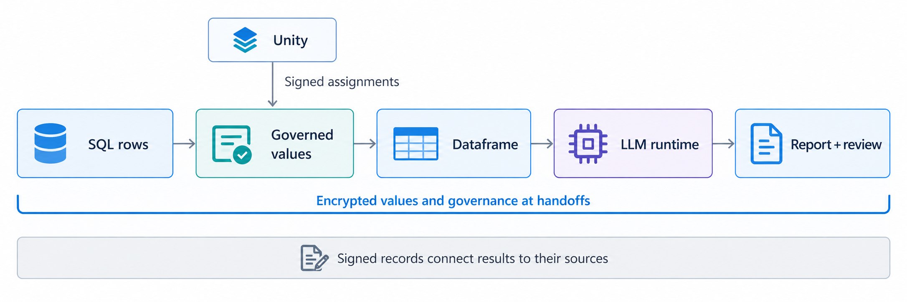
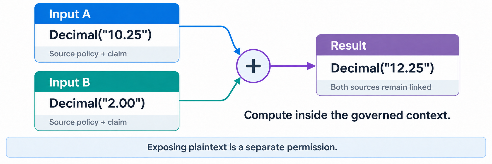
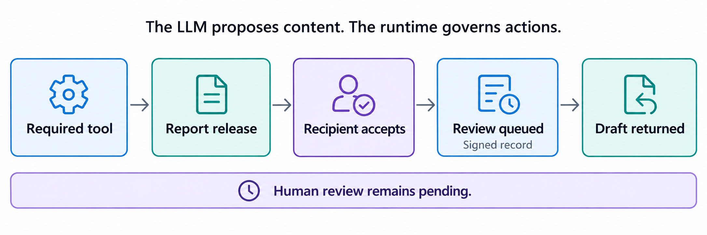

# Examples

## Local policy and scalar values

The local policy example reads [internal_report.policy](../examples/internal_report.policy) from a local file and creates governed values directly in Python. It uses the installed Python package and native TN runtime; Unity, OPA, and a model service are not required.

After the Python installation in [Installation](installation.md#setup), run:

```powershell
python examples/local_policy.py
```

It prints `ACME: 12.75` and verifies 28 signed records. The complete [local_policy.py](../examples/local_policy.py) shows the policy, authorization, publication, and record handling.

The policy allows the `local-report` application to prepare an internal report, requires a signed monitoring record before each protected operation, and permits ordinary-text output only to `internal-console`. The file has a separate policy for the operation records.

The example loads that file and selects its `internal.report` section:

```python
policy_text = Path(__file__).with_name("internal_report.policy").read_text(encoding="utf-8")
with tn.Session(
    policy_text, groups=["values", "evidence"], policy_id="internal_report.policy",
) as session:
    policy = session.policy("internal.report")
```

`session.policy(...)` constructs the governance contract from that section and binds it to the session's signing identity. The application then states which writer, exact policy, operations, and disclosure destination it accepts:

```python
rules = Rules(
    writers=frozenset({session.did}),
    policies=(policy,),
    operations=frozenset({
        "select", "attest", "upper", "add", "concat", "to_string", "reveal",
    }),
    destinations=frozenset({"internal-console"}),
)
```

The policy text records the conditions; the Python evaluator enforces them. In this example it also checks the application and purpose and requires the monitoring action:

```python
def evaluate(request):
    if request.application != "local-report" or request.purpose != "internal-report":
        return Assessment(False, "Application or purpose is not permitted.")
    decision = rules(request)
    return replace(decision, obligations=("monitor",)) if decision.permit else decision
```

The context connects this evaluator to the session and signed recorder. The example's `originate` helper asks it to authorize the local input, records the decision, and calls `Context.originate` with the supplied policy. That call encrypts the value and its governance and publishes the signed result:

```python
name = originate(context, "ACME", policy, "company name")
amount = originate(context, Decimal("12.50"), policy, "amount")
with context:
    name = name.attest("This name identifies the example company.", context)
    total = amount + Decimal("0.25")
    report = name.upper() + ": " + total.as_string()
text = report.reveal(context, destination="internal-console")
```

Both values receive the policy explicitly. Their derivatives retain it and the original claim references. The permitted `reveal` returns an ordinary string and records the disclosure.

This example uses one local identity as both publisher and receiver. Its keys and publications exist for the run, and the script verifies the signed records before closing the session. Reusable endpoints load their existing enrollment with `Session.from_config`. In the SQL workflow below, Unity locates signed policy assignments; here the application supplies the policy file directly.

## SQL-to-report example

Consider an analyst allowed to use market data internally. The data also carries a condition: a report generated by an LLM must display a review notice and be queued for human review. The application should return a useful draft with review pending.

This repository implements that path with synthetic data:



```text
SQLite name/value rows
  -> signed source assignments resolved through Unity
  -> governed strings and numbers
  -> governed Polars filtering, sorting, arithmetic and aggregation
  -> governed report input
  -> native LLM service and required logging tool
  -> encrypted report release and recipient acceptance
  -> signed registration of pending human review
  -> returned draft
```

The model generates report content. The runtime retains source policies, claims, and references to inputs. It checks tool calls and report transfers against the configured rules. Values and governance are encrypted in TN publications. Signed records identify the endpoint responsible for each statement and action.

A source statement remains attached to the data it describes. A recipient can retrieve that statement and verify its author. The receiving application separately checks whether its configured rules recognize that author for the requested use. For example, a statement that a company name is suitable for internal identification does not establish that a generated report is suitable for investment advice.

The application defines the review requirement and supplies the components that perform it. In this example, the model service records report creation, and the Python adapter queues review after the recipient accepts the report. The application returns the draft with review pending. Retaining a statement makes it available for evaluation; the configured rules determine the action. Combining values also records links to each input, so a recipient can trace the result back to its sources.

## Numeric verification



This command uses native encryption and signatures without a Unity or model connection:

```powershell
python -m tn_governed.values.verify_numeric --run-directory experiments/results/numeric-check
```

It checks numeric round trips, arithmetic, type promotion, Decimal precision, equality and hashing, multiple-result operations, references to contributing inputs, claim attribution, authorization, decryption capability and signed records. It writes `numeric-verification.json` and the publications used for verification.

Every run directory must be new. Choose a different directory name for a second run.

## Run SQL through a dataframe

With Unity and OPA available:

```powershell
python -m experiments.pvldb_evaluation.run --mode primitive --rows 3 --numeric-type int --run-directory experiments/results/sql-int
python -m experiments.pvldb_evaluation.run --mode primitive --rows 3 --numeric-type float --run-directory experiments/results/sql-float
python -m experiments.pvldb_evaluation.run --mode primitive --rows 3 --numeric-type Decimal --decimal-precision 38 --decimal-scale 4 --run-directory experiments/results/sql-decimal
```

The runner creates a synthetic SQLite table, publishes signed column assignments, queries governed cells and performs the dataframe calculation. The default scalar step adds one to the aggregate.

| Selected type | Dataframe result for three rows | After the scalar increment |
| --- | --- | --- |
| `int` | `4503` | `4504` |
| `float` | `4503.375` | `4504.375` |
| `Decimal`, precision 38, scale 4 | `4503.3750` | `4504.3750` |

These are expected values for the generated example rows. Check the run's `completed` and `verified` fields for its actual outcome. Decimal values enter SQLite through a `DECIMAL_TEXT` converter and enter Polars with an explicitly declared precision and scale.

To compare explicit input tracking with operator-based tracking, run the same command with `--mode explicit` and a new directory. Both modes use the same authorization, cryptography, dataframe operation and model controls. The explicit adapter passes contributing inputs to a callback; the primitive adapter records them through overloaded operations.

## SQL and dataframe operations

The following excerpt shows the application calls used by `run_case`. Setup supplies `db` and `context`; after the calculation, it configures the model endpoint for the exact `brief`. The complete executable setup is in [run.py](../experiments/pvldb_evaluation/run.py).

```python
from experiments.pvldb_evaluation.frames import dataframe_calculate

# The driver resolves signed source assignments through Unity, checks the
# requested use, and returns TNString/TNNumeric pairs for the selected cells.
rows = db.execute(
    "SELECT name, value FROM market_data LIMIT ?", (3,)
).fetchall()

with context:
    # This statement is attributable to this endpoint. Its subject remains
    # this input name when later calculations carry the statement forward.
    name = rows[0][0].attest(
        "Suitable for identifying the synthetic company in this internal demonstration report.",
        context,
    )
    governed_rows = [(name, rows[0][1]), *rows[1:]]

    # Verify the source assignments and policy files, check OPA
    # permission, and open values inside the governed dataframe operation.
    # The returned aggregate is a governed number with references to its inputs.
    amount = dataframe_calculate(context, governed_rows)

    # Ordinary arithmetic preserves the underlying numeric type.
    # Each value-producing operation publishes a governed result.
    amount = amount + 1
    brief = name.upper() + ": " + amount.as_string() + " demonstration cents"

# The runner prepares NativeModelEndpoint for this exact brief, binds the
# input/output sessions, and starts the governed native model service.
# It sends the encrypted TN publication, including its governance.
with context:
    report = endpoint.generate(
        brief,
        prompt=(
            "Prepare an internal HTML draft from the supplied calculation. "
            "Include the exact carried review notice. Human review is pending."
        ),
    )

# Successful return follows the required native logging tool, native report
# release, recipient acceptance, and signed registration of the review request.
html = report.report_html
pending_review = report.review
```

Inside `dataframe_calculate`, the governed Polars operation is:

```python
# `frame` is a GovernedLazyFrame authorized under all source policies.
result = (
    frame.filter(pl.col("value") >= 0)
         .sort("name")
         .with_columns((pl.col("value") + 250).alias("adjusted"))
         .select(pl.col("adjusted").sum().alias("amount"))
)
# The adapter checks actions required before release, retains source references and
# claims, and publishes the aggregate with its declared numeric type.
```

The context retains signed operation records in memory. A refusal therefore has a record even when no result is produced. Returning plaintext also produces a record, even though the ordinary Python value has no attached governance.

## Run the complete model/report workflow



```powershell
py -3.12 scripts/run_submission.py --unity-url http://127.0.0.1:8080 --numeric-type Decimal --run-directory experiments/results/sql-model-report
```

The example policy requires `log_compliance_creation`, a visible review notice, and registration of human review for the accepted report. Review can remain pending when the draft returns. The application records that state rather than claiming that someone has reviewed it.

The successful order is:

1. The native service completes the required logging tool.
2. The native service releases the governed report, and the receiving application verifies and authorizes it.
3. Python signs and registers the pending-review action for that report.
4. The call returns the draft and review state.

## Calculation and report

This example adds a calculation service between the dataframe and the LLM. It uses two datasets: wealth observations and a calendar that supplies their timestamps. Each dataset has its own signed policy and version record. Unity locates those records, and the source service supplies the encrypted TN publications.

The Polars adapter checks both sources, joins them by observation ID, and orders the rows by timestamp. The resulting wealth sequence is `[100, 120, 90, 110]`. The engine calculates maximum drawdown, the largest decline from a previous peak. Here the peak is 120 and the following low is 90, so `(90 - 120) / 120 = -0.25`, a 25% decline.

### The calculation API

This standalone example calls the same packaged engine used in the governed workflow:

```python
from tn_governed.calculation_client import (
    CalculationRequest, EngineCalculationPort,
)

request = CalculationRequest(
    "max_drawdown", {"wealth_path": [100, 120, 90, 110]},
)
result = EngineCalculationPort().calculate(request)
assert result.value == -0.25
assert result.unit == "decimal"
assert result.method == "peak_to_trough_running_max"
```

In the governed workflow, the application passes the dataframe's TN publication to the calculation adapter:

```python
from tn_governed.calculation import execute_calculation

# Setup has configured work with the calculation session, permitted uses,
# source checks, release checks, and report destination.
execution, calculation_object = execute_calculation(
    EngineCalculationPort(), polars_object, work=work,
)
```

The adapter checks permission before reading the `finance` rows. It requires timestamps with time zones in strictly increasing order, calls the engine, and writes the function, arguments, engine version, method, units, result, and input publication ID into the output. The result is released as a new encrypted, signed TN publication. Both source policies and dataset references remain attached.

The application sends the calculation publication unchanged to the model service. It checks the requested use and source history before making the permitted content available for report generation. The report recipient checks the returned publication before the application saves its HTML. The result can be traced through the calculation and dataframe join to both original datasets. The market-data example above demonstrates the separate requirement to queue human review.

### Run the complete calculation example

Use the Python environment and server build from Setup. Set `TN_LLAMA_MODEL` to your GGUF file and `TN_POLARS_OPA` to OPA if it is not on PATH. Use the same WSL distribution for the build and run. Unity must be running; the supplied installer can start a local instance on port 18080:

```powershell
python scripts/install_unity.py --name tn-calculation-unity --port 18080
```

If that instance already exists, start it with `docker start tn-calculation-unity`. Then run:

```powershell
$env:TN_LLAMA_API_KEY = [guid]::NewGuid().ToString("N")
tn-governed governed-path `
  --run-directory experiments/results/calculation-report `
  --unity-url http://127.0.0.1:18080 `
  --server-binary .runtime/dependencies/tn-llama/llama-server `
  --model "$env:TN_LLAMA_MODEL" `
  --wsl
```

The command creates the example datasets and sessions, resolves their signed records through Unity, performs the join and calculation, runs the native model service, and saves the accepted report. Choose a new run directory for each execution. The command stops its model process when finished. Stop the example Unity container with `docker stop tn-calculation-unity` when you no longer need it.

Inspect `preparation.json` for the calculation and source IDs, `summary.json` for the report ID and counts of accepted policies and dataset bindings, and `report.html` for the generated report. `publications/` contains the encrypted, signed objects. Keep the run directory private because it also contains the local session keys.

The implementation is in [pipeline.py](../src/tn_governed/pipeline.py), [calculation.py](../src/tn_governed/calculation.py), and [native_reference.py](../src/tn_governed/native_reference.py). The pipeline configures the `work` argument shown above and checks the source policies again before releasing the calculation result.

## Inspect the output

Each SQL/dataframe run writes `case-summary.json`. Successful runs have `completed: true` and `verified: true`; failures identify the stage and exception type. Before reporting success, the runner verifies the saved publications and operation records offline.

| Output | Contents |
| --- | --- |
| `market.sqlite` | The generated input rows |
| `run.json` | Source identities, requested use, publications and record checkpoints |
| `dag.json` | Derived values and their contributing input references |
| `frame-verification.json` | Checked dataframe types, source assignments and replayed OPA decisions |
| `publications/` | Exact encrypted, signed TN publications exported after computation |
| `tapes/` | Signed operation records exported by each context |
| `report.html` | Accepted report content, when model generation completes |
| `review.json` | Pending-review registration returned by the application |

The directory name `tapes` means the ordered record exports. Run directories also contain local enrollment material used by the verifier; keep them private. They are excluded from Git.

For the combined numeric/dataframe verification, including conflicting numeric type specifications and range checks:

```powershell
python -m experiments.pvldb_evaluation.verify_numeric_path --run-directory experiments/results/dataframe-check
```

For the smaller SQL/string/numeric demonstration:

```powershell
python -m experiments.pvldb_evaluation.run --mode primitive --numeric-type Decimal --run-directory experiments/results/sql-primitives
python -m tn_governed.values.verify experiments/results/sql-primitives
```
