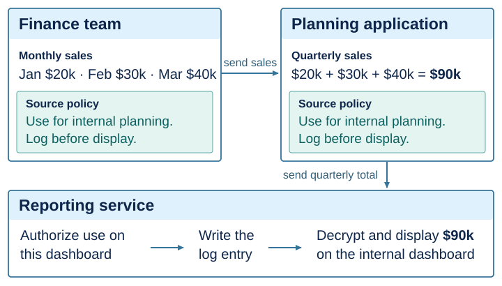
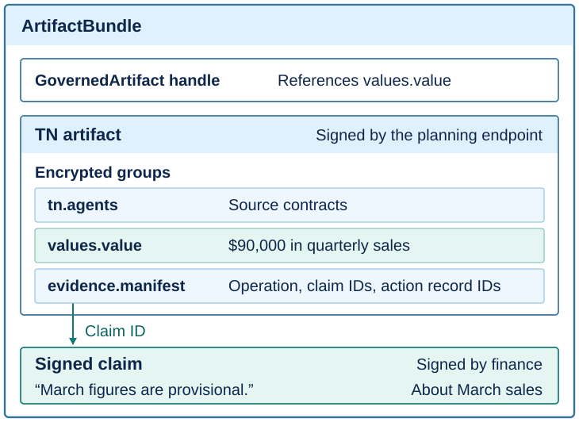

# Governed execution

TN is a wire protocol for sending data together with the rules for using it. When an application calculates a result from governed values, the result carries their policies and any signed claims about them. Each claim still identifies who made it and which values it describes. The receiving application uses a component called an *endpoint* to verify the sender's signature and decide whether to allow the requested use.

A finance team, for example, shares monthly sales figures for internal planning. Its policy requires a log entry before anyone displays the figures. A planning application adds the three monthly figures and sends the quarterly total to a reporting service. The same policy applies to the total. Before returning it for display, the reporting endpoint checks that the dashboard is internal, confirms that the request is for planning, and writes the log entry.

*Figure 1. The planning application signs a publication containing the quarterly total and the finance team's policy.*

## Protocol definition

A **publication** is a signed TN object encoded as JSON. The application that creates it, called the *writer*, encrypts fields in named groups. It stores the source policies in the `tn.agents` group and signs a hash of the publication metadata and encrypted groups with Ed25519. The encryption binds each data group to its policies. If the writer designates a group as the manifest, the encryption also binds the data to that manifest.

A **source contract** specifies the rules for using a source value. It names the governing authority and identifies the policy by a reference that includes a hash of its contents. The writer and the governing authority can be different parties. The five required clauses are `instruction`, `use_for`, `do_not_use_for`, `consequences`, and `on_violation_or_error`.

The Python `Endpoint` publishes a protected JSON value as an object of type `tn.artifact`. The `values.value` field holds the value. The `evidence.manifest` field identifies the operation that produced it and lists any claim and action record IDs. Each claim is a separate signed statement about specific fields. Inside an application, a `GovernedArtifact` refers to the published value. To send the value to another endpoint, the sender packages that reference, the signed publication, and its supporting records in an `ArtifactBundle`.

*Figure 2. The planning application signed the quarterly total. The finance team signed the statement that March sales were provisional. Its statement still refers to March.*

### Endpoint operations

1. **Receipt.** The receiving endpoint verifies the writer's signature, checks the source contracts against its local authority rules, and verifies the manifest and the records it cites. It returns a reference to the protected value, which stays encrypted.
2. **Use.** The endpoint's policy evaluator considers the requesting application, purpose, operation, inputs, parameters, and destination in light of the source policies and claims. If the evaluator permits the request, the endpoint runs the required actions and records evidence of completion. It then decrypts the inputs and calls the application's computation. A denial, an incomplete action, or a missing decryption key stops execution before that call.
3. **Derivation.** For inputs `x₁, …, xₙ` and result `y`, the policies on `y` are the union of the source contracts on the inputs. The endpoint identifies each contract by its authority, policy reference, and revision if specified. If two inputs give different terms for the same contract, the endpoint rejects the operation. Otherwise, it signs a new publication for `y` with those contracts and the original claim references.
4. **Disclosure.** Returning an ordinary value requires a separate request that names the destination. The endpoint authorizes that request, completes its required actions, opens the value, and records the disclosure before returning it. After disclosure, the receiving application controls the plaintext.

The [native writer](../native/tn-llama/upstream/tn-proto/crypto/tn-core/src/governed/writer.rs) and [reader](../native/tn-llama/upstream/tn-proto/crypto/tn-core/src/governed/reader/mod.rs) implement the wire format. The [artifact schema](../src/tn_governed/artifact_types.py) and [verifier](../src/tn_governed/artifact_verification.py) define the fields and checks specific to `Endpoint`.

## Execution and disclosure

| Method | Input and result |
| --- | --- |
| `Endpoint.originate(value, policies=...)` | Publishes an initial value under one or more source policies and returns its handle. |
| `Endpoint.execute(operation, inputs, compute, parameters=..., destination=...)` | Passes the authorized input values to `compute` as a tuple and returns a governed handle for its JSON result. |
| `Endpoint.export(artifact)` and `Endpoint.receive(bundle)` | The sender packages an artifact for transfer. The receiver verifies the bundle and returns a handle it can use locally. |
| `Endpoint.reveal(artifact, destination=...)` | Returns the ordinary value after recording a signed `Disclosure` for the named destination. `GovernedBoundary` accepts only governed handles. |

## Authority and required actions

An endpoint evaluator accepts a `Request` and returns an `Assessment` with a decision and a list of required actions in execution order. The built-in `AuthorityEvaluator` supports two ways to combine policy decisions. In `all` mode, every matching rule must permit the request. In `precedence` mode, the endpoint selects the highest-ranked authorities in each policy domain. Every selected rule must permit the request, including rules tied for the highest rank. The assessment records each vote, how the evaluator treated each claim, and which actions it requires. Conflicting actions or circular dependencies cause the evaluator to deny the request.

`Endpoint` calls each action handler in order. The handler reports success with `ObligationResult(True, evidence)`, where `evidence` is a nonblank reference to the completion record. The endpoint signs the reported outcome before calling the next handler. If a handler fails, the endpoint keeps the earlier signed observations and stops the operation. Each handler is responsible for retrying its external action, preventing duplicate effects, or reversing the action when needed.

## Claims and value history

`Endpoint.attest()` signs a claim about a governed artifact. `Endpoint.dispute()` signs a second statement that identifies the disputed claim. A derived publication retains both statements with their original issuers and subjects.

`ValueHistory(endpoint)` keeps versions of a named value in memory and records each change in a signed record. When an application updates, deletes, or restores a value, the history checks that the version being changed is still current. Deleting a value marks it unavailable for use. Restoring it requires an active replacement and records both the deleted version and its replacement.

`ValueHistory.export()` returns a `HistorySnapshot`. If the caller supplies a path, the method also writes the snapshot to disk atomically. A path supplied to `ValueHistory(path, endpoint)` sets the default export location. `ValueHistory.receive(snapshot, endpoint)` verifies the signed changes before setting the current version of each value.

## Adapter admission

`Endpoint.import_publication()` selects a field from a native publication and accepts supporting publications and an optional content validator. It verifies that each claim is cited by the field's signed metadata or names the field itself as a subject. The endpoint obtains authorization and completes required actions before opening the field or invoking the validator. The resulting artifact retains the claims and action evidence attached to that field.

`tn_polars.import_frame(endpoint, publication, publications=...)` verifies the encrypted audit metadata and signed claims. Once the endpoint authorizes the import, the adapter validates the dataframe rows. The signed operation parameters retain the audit record, including the level of detail the source recorded about which inputs contributed to the result.

## Implementation modules

| Component | Inputs, operation, and output |
| --- | --- |
| `GovernedSQL` in `values/sql.py`, `query.py`, and `query_result.py` | Accepts SQL and typed parameters, resolves source policies and dependencies, and publishes signed positional query results. |
| `GovernedLazyFrame` in `dependencies/tn-polars/tn_polars` | Accepts admitted dataframe publications and registered expressions or plans; returns governed frames and signed releases with contributor metadata. |
| `ToolWorkflow` in `tool_runtime.py` | Accepts registered `Call` records over governed inputs; returns validated tool completions and a governed workflow result after release checks. |
| `AuthorityEvaluator` in `endpoint_policy.py` | Accepts a requested use and source contracts; returns local policy judgments and ordered required actions. |
| `GovernedBoundary` in `boundaries.py` | Validates governed input handles before passing artifacts to a protected operation. |
| `ValueHistory` in `value_history.py` | Applies signed value transitions with predecessor checks; returns retained versions and exportable snapshots. |

`tests/test_governed_pipeline.py` verifies SQL, Polars, claims, dependent tools, a required ledger action, and recipient verification using separate sessions and stores. Component tests cover contributor mappings, exact value transport, refusals, partial action failures, authority precedence, concurrent endpoints, and value history.
