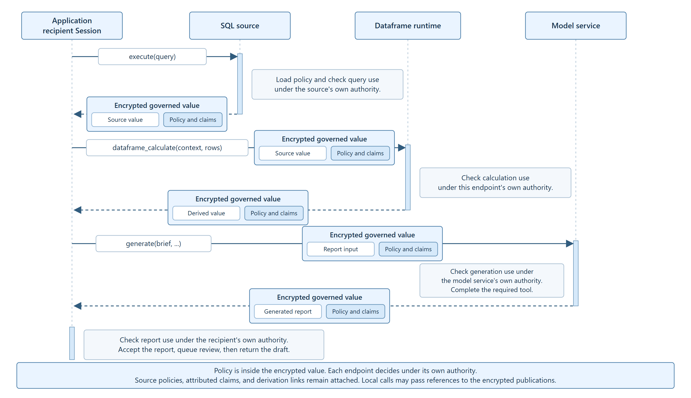

# Interfaces and source layout

## Source layout

The installed `tn_governed.values` package provides `TNString`, `TNNumeric`, `Context`, and `GovernedSQL`. Application adapters are in `tn_governed`; the paper's workload drivers are in `experiments/pvldb_evaluation`.

| Source | What to read |
| --- | --- |
| [endpoints.py](../src/tn_governed/endpoints.py) | Endpoint authorization, governed artifacts, claims, and transfer |
| [tool_runtime.py](../src/tn_governed/tool_runtime.py) | Registered tool calls, dependencies, and release |
| [governed_tools.py](../examples/governed_tools.py) | Runnable tool workflow with explicit local policy |
| [local_policy.py](../examples/local_policy.py) | Local policy loading, explicit rules, governed values, and signed records |
| [internal_report.policy](../examples/internal_report.policy) | The conditions supplied by the application owner |
| [numeric.py](../src/tn_governed/values/numeric.py) | Numeric operators and preservation of the underlying Python numeric type |
| [string.py](../src/tn_governed/values/string.py) | Governed string methods, slicing, concatenation and exposure |
| [primitives.py](../src/tn_governed/values/primitives.py) | Authorization, opening values and publishing derived values |
| [obligations.py](../src/tn_governed/values/obligations.py) | Ordered required actions and retained completion evidence |
| [sql.py](../src/tn_governed/values/sql.py) | Resolving source governance and returning governed SQL cells |
| [query.py](../src/tn_governed/values/query.py) | SQLite source discovery, read snapshots, trusted functions, and contributor contracts |
| [query_result.py](../src/tn_governed/values/query_result.py) | Signed query results with positional cells and authorized disclosure |
| [audit.py](../dependencies/tn-polars/tn_polars/audit.py) | Dataframe operation records, evaluator decisions, contributor support, and output verification |
| [frames.py](../experiments/pvldb_evaluation/frames.py) | SQL cells through governed Polars and back to a governed number |
| [numeric_profile.py](../experiments/pvldb_evaluation/numeric_profile.py) | Exact dataframe types and range checks |
| [policy_accumulation.py](../experiments/pvldb_evaluation/policy_accumulation.py) | Policies, input references, claims, and disclosure after filtering and aggregation |
| [Native server](../native/tn-llama) | Rust governance runtime, TN cryptography, C++ integration and pinned llama.cpp patch |
| [model.py](../src/tn_governed/values/model.py) | Native transfer to the model service and registration of pending review |
| [tool_evidence.py](../dependencies/tn-llama-client/tn_llama_client/tool_evidence.py) | Configured tool names, input sections, and signed completion types |
| [run.py](../experiments/pvldb_evaluation/run.py) | Complete setup, execution and verification of the submission example |
| [evidence.py](../src/tn_governed/values/evidence.py) | Signed records of each context's operations |

`TNString` subclasses `str`, with a locator in the inherited string buffer. Its protected content is in the TN publication. `TNNumeric` refers to an encrypted number. Its numeric operators preserve `int`, `float`, and `Decimal` behavior by applying operations to the underlying values inside the authorized runtime. Scalar complex results are also supported. The SQL/dataframe example supports integers, floats and decimals.

`TNString.upper()` returns a governed string after operation authorization. `TNString.reveal(context, destination=...)` returns an ordinary string after the configured evaluator authorizes disclosure and the native session decrypts the content. String metadata methods use declared facts where available.

`GovernedSQL.execute_query(sql, parameters)` returns a governed relation. SQLite prepares the query without executing its expressions; the gateway resolves signed assignments for the discovered value and control dependencies before execution. The publication binds the query, typed parameters, database snapshot, source assignments, output schema, and contributor mapping. `fetchall()` returns positional `QueryCell` handles, so duplicate aliases and equal values remain distinct. `reveal(destination)` authorizes disclosure of the relation or a selected cell. `execute` retains primitive handles for direct-column projections and uses the relation interface for other queries.

The built-in SQL dependency mapping tracks positive row contributors for instrumented base-table projections, joins, groups, and aggregate windows, while retaining snapshot-scoped selection and matching dependencies. Query shapes whose projection augmentation could alter semantics execute the original statement with source-scoped dependencies and unknown row support. Each source assignment must permit the recorded precision through its `sql_lineage` rule. `SQLFunction` registrations identify trusted user-defined functions and their additional source dependencies. These interfaces use the database engine's query language and the endpoint's configured provenance capabilities.

`Endpoint.evaluator(request)` returns an `Assessment` containing a decision and ordered required actions. `Endpoint.obligations` maps each action name to its registered handler. A handler completes an action by returning `ObligationResult(True, evidence_reference)` with a nonempty string reference. If a later handler fails, the signed decision retains earlier completion references and identifies the failed action; protected processing stops. This record does not roll back external actions. Their handlers own retry, idempotency, and compensation behavior.

Native dataframe releases carry `tn_polars_audit` beside their rows. The audit records source editions, policy-artifact hashes, operation parameters, evaluator requests and decisions, output bindings, and contributor support. `open_audited_frame` authenticates the publication and checks these bindings. `open_audited_frame(..., expected_artifacts=...)` accepts hashes from admitted editions; its optional `evaluator_for` callback resolves evaluators for replayed policy requests. The verifier inspects recorded expressions without executing them.

`NativeOutputReader` accepts `ToolEvidenceExpectation` records through `tool_expectations` and mandatory tool names through `required_tools`. `NativeOutputReader.open()` requires valid signed completion evidence for each mandatory name before decrypting output content. An empty required set supports workflows without tool prerequisites; configured optional evidence is still validated when supplied. `expected_request_digest` additionally binds signed completions to a trusted submitted request. `submit_governed_report(..., bind_request=True)` derives that digest from the request it sends and supplies it during recipient admission.

## Policy across endpoints

In the SQL-to-model example, `GovernedSQL`, `GovernedLazyFrame`, and `tn-runtime` evaluate the requested operation under separately configured identities and policies. `NativeOutputReader` verifies the returned publication using a separate recipient session.

Each encrypted governed value contains both its content and its governance in a signed TN publication. Local calls can pass references to those publications. Derivatives retain source policies, claim attribution, and derivation links; the model runtime preserves these when it publishes the report.

Each `Endpoint` instance applies its configured authority rules to the input policies and claims. Unity Catalog resolves signed policy records. The configured endpoint evaluator authorizes computation and disclosure. The local policy example runs in one Session; the full SQL-to-report example uses separate Sessions.
